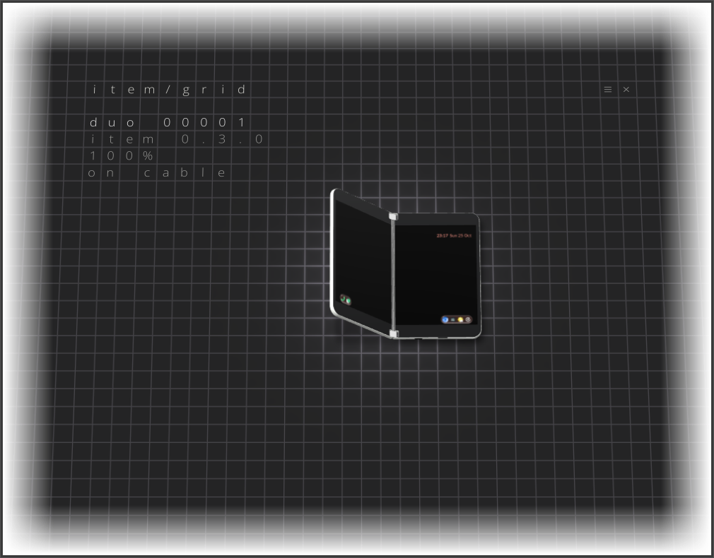
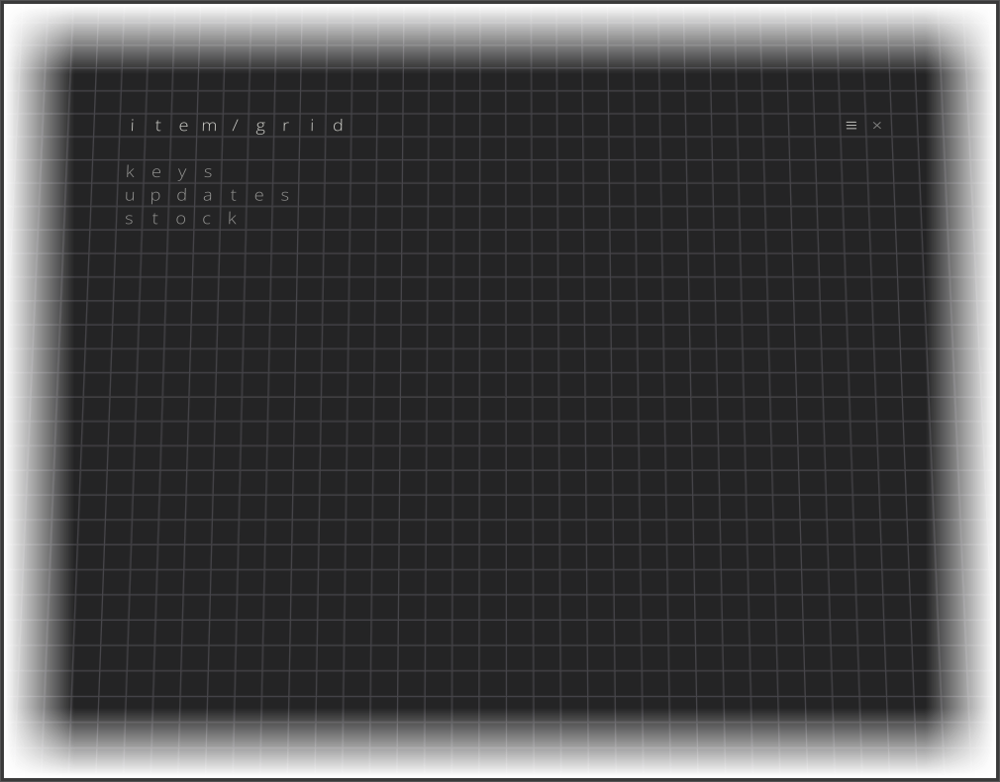

# item/grid

**item/grid** looks after a connected Surface Duo from a Linux computer, in
the spirit of a desktop's page for a connected phone: it sees what the phone
is doing, installs and updates [item](https://github.com/agentsco-lab/item)
and the port, reads the phone's logs, takes screenshots, backs the phone up
and - by the safety rules learned on this device, as code - RAM-boots and
writes images to it, installs the whole system from a release image, and
takes the phone back to stock Android and to Linux again - through a
recovery of its own, its steps on the phone's screen. A phone it installs
comes up already on the computer's Wi-Fi, in its time zone. The command is
`itemgrid`; the window is item/grid. The release images (`item-duo1-…` in
[item's releases](https://github.com/agentsco-lab/item/releases): the
image, the kernel, the recovery, a manifest) go in
`~/.local/share/itemgrid/releases/<name>/`.

**Until 1.0, item/grid is an experiment**, as item is. It writes to the
phone's partitions, so the rules below are checks in its core that cannot be
gone around, not notes to remember - but it has been used on one phone, the
owner's, from one Linux computer. Keep your own backups of `boot_a`,
`boot_b` and `misc` before you let it write anything.

## What it does

`itemgrid --help` is the list; the main ones:

| | |
|---|---|
| `status` | what the phone is doing; on Linux the versions of item and the port, the battery, heat, free space, uptime, failed services |
| `update` | build item, install it, reboot, wait until it runs (`--no-build`: install what is built) |
| `logs` | the phone's journal: a boot, a unit, a pattern, since a time; saved to a file for a ticket |
| `run`, `shell` | a command (sent as a script) or a shell on the phone, as root or as its owner; the dangerous ones refused |
| `screenshot` | both panels as one PNG, through item's live mirror of the screen |
| `backup` | device data (once), the boot chain, home and settings; `full`: the whole system from TWRP |
| `slots`, `confirm`, `ramboot` | the two boot slots and their state; a boot image tried from RAM first, by the rules |
| `install` | erase and install item from a release image (`--keep-files` keeps home, Wi-Fi, the time zone, the PIN) |
| `stock`, `android` | Microsoft's packages and their boot chain; the way to stock Android and back |
| `keys` | the phone's keyring from the computer: `set NAME` (from stdin), `set-all FILE`, `list`, `forget NAME` - item/grid keeps no copy |
| `wifi` | the Wi-Fi this computer is on, its time zone and the zone's city for the weather, given to the phone (the password never shown) |
| `bootimg` | boot images: `info`, `unpack`, `repack` (a ramdisk, a kernel, a DTB, the command line) - in place of AOSP's mkbootimg |
| `fastboot`, `adb` | item/grid's own fastboot and adb, for trying them by hand (`adb --android` for stock Android) |

**The window** shows the Duo drawn as it is held - the hinge and the
gravity from the phone's sensors, its screen live from item's mirror - on a
table of light, and a few lines on how it is: item's version, the battery,
the link. The menu is lines drawn on the same table: *keys* (the phone's
keyring), *updates* (item's version and build; the update), *stock* (the
way back to the phone's Android); Developer Mode adds one with the
slots, images from RAM, every kind of backup and the logs. The table's look
is in the word itself: three of its cubes turn the grid's colour, strength
and width round on a click, and its `/` turns *item/grid* into *edge/lit*,
where they turn the rim and the light. What is not on the table yet is the
command line's.

**item-recovery** (`crates/recovery`) takes TWRP's place: the port's kernel
with a static Rust init and adb daemon, busybox and mke2fs, 19 MB. item/grid
RAM-boots it, never writes it; its screen on both panels is the table's
grid - the colour, strength and width the window has - with the step at
work, its progress and the phone's item id. It comes with the system image;
`tools/build-recovery.sh` builds it here.

| | |
|---|---|
|  |  |
| The window: the Duo as it is held, its screen live from item's mirror; beside it its item id, item's version, the battery, the cable. | The menu, drawn on the table as the rest; the phone put away under it. |

`itemgrid status`, the same phone:

```
Phone:     Linux (172.16.42.1)
System:    Droidian 102 (2026-10-21), kernel 4.14-190-perf-microsoft-surfaceduo, up 0 h 19 min
item:      0.3.1 (built 2026-10-26 01:54), running
Port:      0.22.1, sensorfw 0.14.8+itemae3
Fingers:   1 enrolled
Battery:   100%, discharging, 26 °C
CPU:       32 °C
Disk /         79.4 GB free of 89.3 GB
Disk /userdata 9.9 GB free of 101.9 GB
```

## The safety rules, as code

Learned on the device; each is a check in `crates/core`, not a thing to
remember.

- **Writing to the phone:** RAM boot first and always; one change per boot;
  a backup before any write; never in one click. An image is written to a
  slot only once it booted Linux from RAM on that phone.
- **Never read `/sys/kernel/debug/gpio` on the Duo:** it resets the phone at
  once. Such commands are refused, as is writing block devices through `run`.
- **Updates go through a reboot:** restarting the vendor hwcomposer resets
  the phone about one time in three.
- **Commands are sent as a script file.** A `pkill -f` pattern sent inline
  over ssh matches its own shell and kills it.
- **The owner's settings, keys and system are left as they were.**

## How it is built

Rust, GTK4 and libadwaita.

| | |
|---|---|
| `crates/core` | `itemgrid-core`: what the phone is doing, every action and every safety rule; the command line and the window only show what is here |
| `crates/cli` | `itemgrid`, the command line over the core |
| `crates/gui` | `itemgrid-gui`, the window: the table, the phone drawn as it is held, the night and day |
| `crates/motion` | `duo-motion`, run on the phone over ssh while the window follows it: the hinge, the lid and the gravity from sensorfw |
| `crates/mcp` | `itemgrid-mcp`, an MCP server that lets Claude Code look at the window and try it with a real pointer, on a screen of its own |
| `crates/recovery` | `item-recovery`, the recovery item/grid RAM-boots: PID 1, the adb daemon, the screen on both panels (DRM) |
| `crates/install` | `itemgrid-install`, the installer for a computer without item/grid - Windows first: item on a Duo from stock Android, in one go, with adb, fastboot and the USB alone (no ssh); the release and the tools fetched by itself |
| `tools/` | `package-deb.sh`, `install-local.sh`, `fetch-fonts.sh`, `package-windows.sh`, `build-recovery.sh` |

The phone is reached over ssh on the USB link (172.16.42.1), or over Wi-Fi
once the cable has shown its key. Where Linux is not running, item/grid
speaks fastboot and adb itself, over USB (`core/src/fb.rs`, `adbusb.rs`):
the bootloader, item-recovery, and stock Android - signed in with the key
platform-tools' adb made on this computer, so a phone that trusted adb
trusts item/grid with no tap. platform-tools are needed only for TWRP, the
fallback recovery (`ITEMGRID_FASTBOOT=platform`, `ITEMGRID_ADB=platform`
give them the rest back). The installer alone does without ssh: it knows
Linux came up by the phone's USB network gadget, and writes the boot chain
from TWRP after the owner's forced restart (the parking brake parks it in
fastboot) - the same rules, one more step by hand.

```
cargo build --release
install -Dm755 target/release/itemgrid     ~/.local/bin/itemgrid
install -Dm755 target/release/itemgrid-gui ~/.local/bin/itemgrid-gui
```

The installer for Windows is cross-built here (`apt install mingw-w64`,
`rustup target add x86_64-pc-windows-gnu`): `tools/package-windows.sh`
leaves `target/windows/itemgrid-install-<version>-windows.zip`. `cargo
build -p itemgrid-install` builds it for this computer too (`--fetch-only`
brings the image here and stops).

## License

MIT, see [LICENSE](LICENSE).
